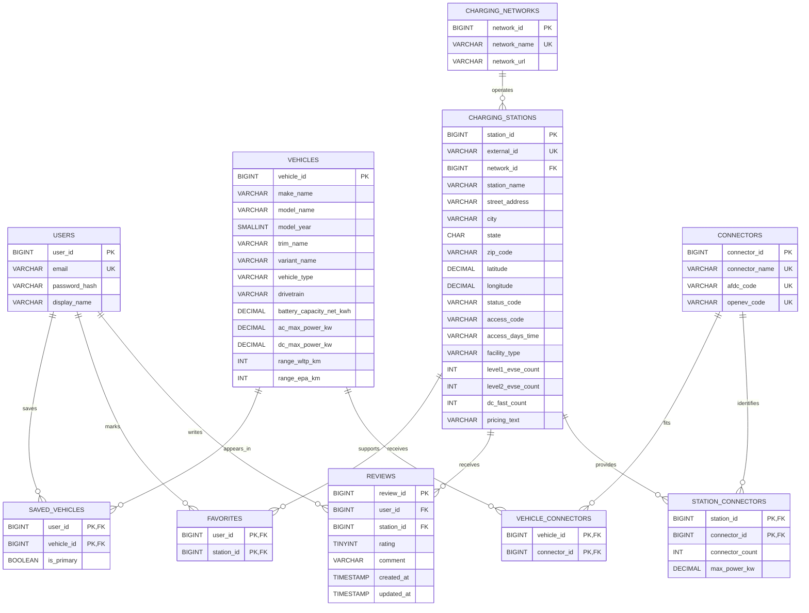

# EVFinder Database Design

This design keeps the ten relations from the conceptual model and adds the constraints and attributes required by the API contract and data-import workflow.

The executable schema is stored at `docker/mysql/init/001-schema.sql`. Future ERD PDFs and database-design notes belong in this directory, while executable SQL remains with the Docker database configuration.

## Entity Relationship Diagram

## Implementation Decisions

- Table names are plural and use `snake_case`.
- `charging_stations.external_id` supports repeatable imports from an external data source.
- `station_connectors` stores connector count and maximum power because those values belong to a station-connector pair.
- Connector count and power are nullable because the AFDC CSV does not always provide those values per connector type. `NULL` means unknown; zero means none.
- `reviews` has a unique constraint on `(user_id, station_id)`.
- `saved_vehicles` uses a generated nullable key so that each user can have at most one primary vehicle.
- MySQL does not allow the generated-column design to be combined with cascading foreign-key actions on this table, so saved-vehicle rows must be removed explicitly before deleting their user or vehicle.
- Search and review-list indexes reflect the current API contract. Indexes will be evaluated with `EXPLAIN` after realistic data is imported.
- Vehicles, favorites, and saved vehicles remain part of the complete design but do not have to be exposed in the first MVP API.
